# Punto de Venta Dolorense

Aplicación móvil en Flutter con SQLite local, desarrollada con TDD para la materia de Desarrollo Móvil Integral.

- **Alumno:** Aguilar Ortiz Gael Alejandro
- **Grupo:** GTID235
- **Institución:** Universidad Tecnológica del Norte de Guanajuato (UTNG)
- **Profesor:** Anastacio Rodríguez García

## Descripción

Punto de venta que guarda productos y ventas en SQLite dentro del teléfono (funciona sin internet), calcula total, IVA incluido y cambio con centavos enteros, descuenta el inventario dentro de una transacción y obtiene el corte del día.

## Arquitectura

- `lib/dominio/`: reglas del negocio en Dart puro (dinero, producto, carrito, venta, excepciones).
- `lib/datos/`: SQLite (base de datos, repositorio de productos y de ventas).
- `lib/presentacion/`: ViewModel y pantalla de caja.
- `test/`: pruebas de dominio y de datos.

## Evidencias por ronda

### Ronda 0 · Preparar el taller
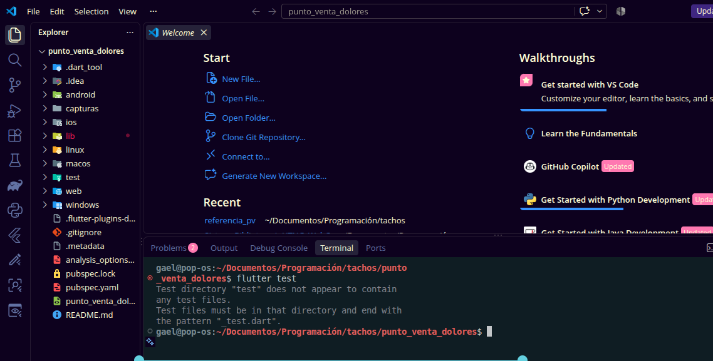

### Ronda 1 · El dinero
**Rojo**
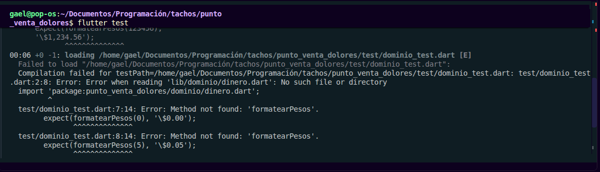

**Verde**
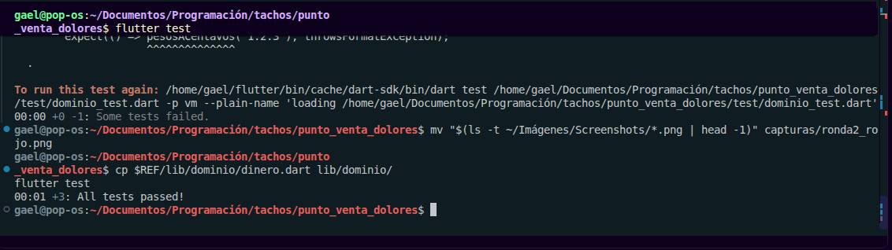

### Ronda 2 · El Producto
**Rojo**
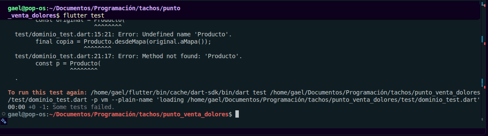

**Verde**
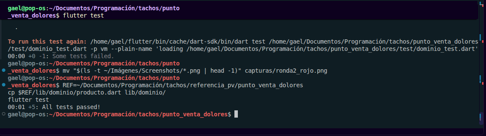

### Ronda 3 · El Carrito
**Rojo**
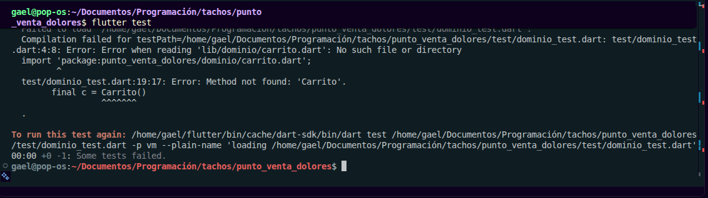

**Verde (11 pruebas de dominio)**
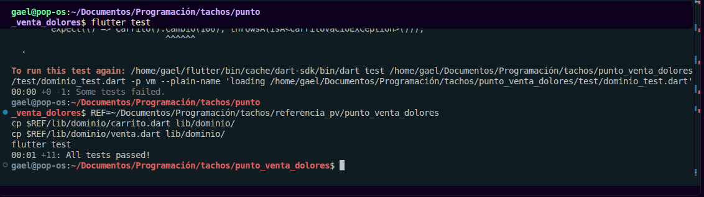

### Ronda 4 · Base de datos local
**Rojo**
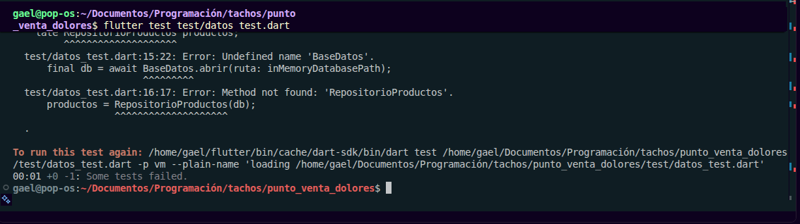

**Verde**
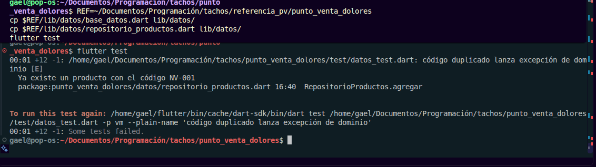

### Ronda 5 · Cobrar con transacción
**Rojo**
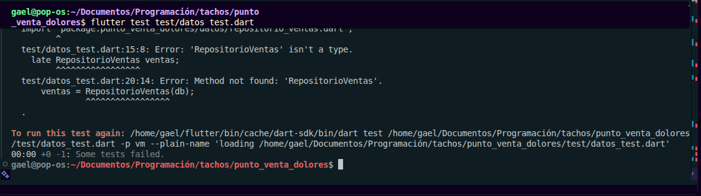

**Verde (todas las pruebas)**
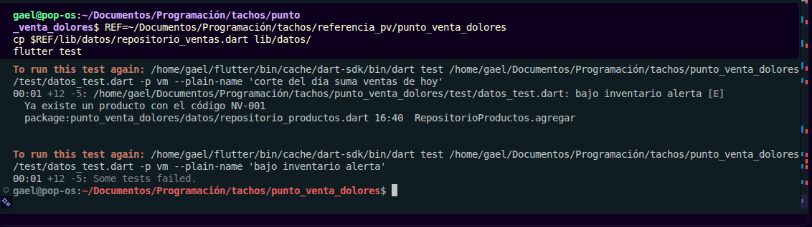

### Ronda 6 · ViewModel y pantalla
**App con el catálogo**
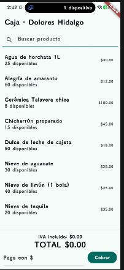

**Carrito con productos**
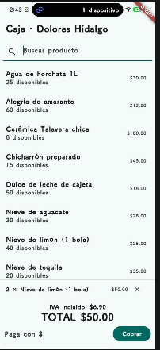

**Cobro con cambio**
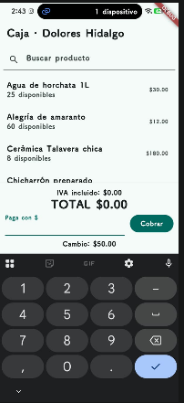

## Cómo ejecutar

```bash
flutter pub get
flutter test
flutter run
```

## Checklist de calidad

- [x] Todo el dinero está en centavos enteros
- [x] El dominio no importa Flutter ni sqflite
- [x] Cada regla nació de una prueba roja
- [x] Cobrar usa una transacción y se probó el caso de fallo
- [x] Los errores técnicos se traducen a excepciones de negocio
- [x] La pantalla no contiene reglas de negocio
- [x] `flutter test` termina completamente en verde
